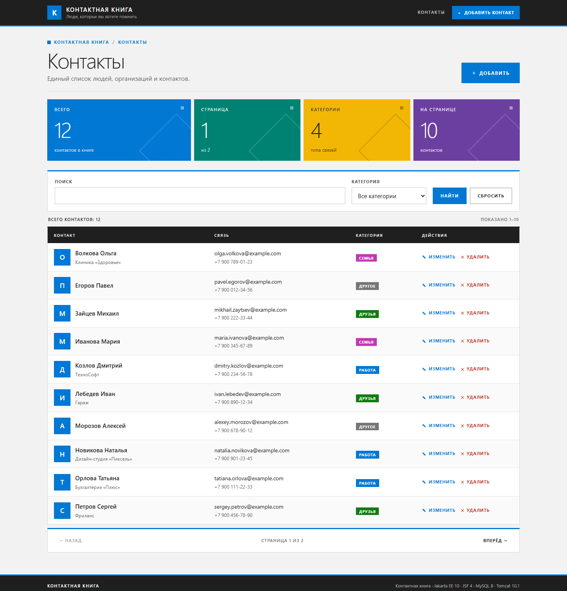

# Контактная книга

[](https://github.com/bishop777220/deepseekPoligon/actions/workflows/ci.yml)

Веб-приложение для ведения списка контактов: поиск, фильтрация по категориям, постраничный вывод,
создание, редактирование и удаление записей. Полноценный CRUD-пример на стеке
**Jakarta EE 10 / JSF 4 / CDI 4 / JPA 3.1 / MySQL 8 / Tomcat 10.1**.

Интерфейс оформлен в стиле **Metro UI**: плитки, плоские панели и строгая типографика Segoe UI.



## Стек

| Слой | Технология |
|------|------------|
| Контейнер | Apache Tomcat 10.1 (Servlet 6.0, Jakarta EE 10 namespace) |
| UI | Jakarta Faces 4.0 (Mojarra 4.0.5), Facelets/XHTML, HTML5, CSS в стиле Metro UI |
| CDI | Weld 5.1.3 (`weld-servlet-shaded`) |
| Персистентность | Jakarta Persistence 3.1, Hibernate ORM 6.4.4, HikariCP |
| Валидация | Jakarta Bean Validation 3.0, Hibernate Validator 8.0 |
| БД | MySQL 8.0+ (utf8mb4) |
| Сборка | Maven 3.9+, Java 17+ |

> Tomcat 10.1 — сервлет-контейнер, а не полный сервер Jakarta EE. Поэтому JSF, CDI, JPA
> и Bean Validation поставляются вместе с WAR-файлом, а не предоставляются контейнером.

## Возможности

- Список контактов с поиском по имени, фамилии, e-mail и организации.
- Фильтр по категории: работа, семья, друзья, другое.
- Постраничный вывод (10 записей на страницу).
- Создание и редактирование с серверной валидацией (обязательные поля, формат e-mail, длины).
- Проверка уникальности e-mail без учёта регистра.
- Удаление с подтверждением и flash-сообщениями после redirect.
- Русский интерфейс, UTF-8 на всех уровнях, адаптивная вёрстка.
- Оформление в стиле Metro UI: плитки-показатели, плоские панели, тёмный app bar.
- Собственная страница ошибки.
- Unit-тесты персистентного слоя на H2 в режиме MySQL (без внешней БД).

## Быстрый старт

### 1. База данных

Вариант A — локальный MySQL:

```bash
mysql -u root -p --default-character-set=utf8mb4 < database/schema.sql
```

Скрипт создаёт базу `testdeepseekv1`, пользователя `contactbook` с паролем `contactbook`,
таблицу `contacts` и 12 демонстрационных записей.

Вариант B — Docker:

```bash
docker compose up -d
```

Дождитесь статуса `healthy` (`docker compose ps`) и переходите к сборке.

### 2. Сборка

В репозитории есть Maven Wrapper (Maven 3.9.16), поэтому отдельная установка Maven не нужна:

```bash
./mvnw clean package          # Linux / macOS
mvnw.cmd clean package        # Windows
```

Если Maven уже установлен, можно использовать `mvn clean package`.

Готовый файл: `target/contactbook.war`.

### 3. Деплой в Tomcat 10.1

```bash
cp target/contactbook.war "$CATALINA_HOME/webapps/"
"$CATALINA_HOME/bin/startup.sh"        # Windows: %CATALINA_HOME%\bin\startup.bat
```

Откройте <http://localhost:8080/contactbook/>.

Остановка: `"$CATALINA_HOME/bin/shutdown.sh"` (Windows: `shutdown.bat`).

### 4. Параметры подключения

По умолчанию приложение подключается к
`jdbc:mysql://localhost:3306/testdeepseekv1?useSSL=false&allowPublicKeyRetrieval=true&serverTimezone=UTC`
пользователем `contactbook`/`contactbook`. Значения можно переопределить переменными
окружения (удобно для Tomcat) или JVM-свойствами:

| Переменная окружения | JVM-свойство | По умолчанию |
|----------------------|--------------|--------------|
| `CONTACTBOOK_DB_URL` | `contactbook.db.url` | `jdbc:mysql://localhost:3306/testdeepseekv1?useSSL=false&allowPublicKeyRetrieval=true&serverTimezone=UTC` |
| `CONTACTBOOK_DB_USER` | `contactbook.db.user` | `contactbook` |
| `CONTACTBOOK_DB_PASSWORD` | `contactbook.db.password` | `contactbook` |

Если база и пользователь уже созданы и пароль отличается от `contactbook`, задайте
`CONTACTBOOK_DB_USER` и `CONTACTBOOK_DB_PASSWORD`; схему в этом случае выполняйте
от имени пользователя с правами на `testdeepseekv1`.

Пример `setenv.bat` для Windows (файл `%CATALINA_HOME%\bin\setenv.bat`):

```bat
set "CONTACTBOOK_DB_URL=jdbc:mysql://localhost:3306/testdeepseekv1?useSSL=false&allowPublicKeyRetrieval=true&serverTimezone=UTC"
set "CONTACTBOOK_DB_USER=contactbook"
set "CONTACTBOOK_DB_PASSWORD=contactbook"
```

Пример `setenv.sh` для Linux/macOS:

```bash
export CONTACTBOOK_DB_URL='jdbc:mysql://localhost:3306/testdeepseekv1?useSSL=false&allowPublicKeyRetrieval=true&serverTimezone=UTC'
export CONTACTBOOK_DB_USER='contactbook'
export CONTACTBOOK_DB_PASSWORD='contactbook'
```

## Тесты

```bash
./mvnw test          # Linux / macOS
mvnw.cmd test        # Windows
```

Тесты поднимают in-memory H2 в режиме MySQL, создают схему через Hibernate и проверяют
CRUD, поиск, пагинацию, уникальность e-mail и удаление. Внешний MySQL для тестов не нужен.

## CI

В репозитории настроен GitHub Actions (`.github/workflows/ci.yml`): на каждый push в `main`
и pull request собирается WAR, запускаются тесты на JDK 17 (Temurin), готовый артефакт
`contactbook.war` загружается в artifacts сборки.

```bash
./mvnw -B -ntp verify
```

## Структура проекта

```text
contactbook/
├── database/schema.sql                  # схема + демо-данные
├── docker-compose.yml                   # MySQL 8.4 для локального запуска
├── docs/screenshot.png                  # скриншот интерфейса
├── mvnw, mvnw.cmd, .mvn/                # Maven Wrapper
├── pom.xml
├── src/main/java/ru/example/contactbook/
│   ├── config/DatabaseConfig.java       # env/property-переопределения JDBC
│   ├── model/Contact.java               # JPA-сущность + Bean Validation
│   ├── model/ContactCategory.java
│   ├── service/ContactService.java      # CRUD, поиск, пагинация, транзакции
│   ├── service/DuplicateEmailException.java
│   └── web/                             # CDI-бины, фильтр, сообщения
├── src/main/resources/
│   ├── META-INF/persistence.xml
│   ├── messages.properties              # русские тексты UI
│   └── ValidationMessages.properties
├── src/main/webapp/
│   ├── WEB-INF/web.xml
│   ├── WEB-INF/beans.xml
│   ├── WEB-INF/faces-config.xml
│   ├── WEB-INF/templates/layout.xhtml
│   ├── index.xhtml                      # список + поиск + пагинация
│   ├── edit.xhtml                       # создание/редактирование
│   ├── error.xhtml
│   └── resources/css/app.css
└── src/test/java/ru/example/contactbook/ContactServiceTest.java
```

## Как это устроено

- **JSF + CDI.** Страницы на Facelets (`*.xhtml`), бины `@Named` + `@ViewScoped`,
  внедрение зависимостей через CDI. Weld стартует через `ServletContainerInitializer`
  из `weld-servlet-shaded`, поэтому отдельный listener в `web.xml` не нужен.
- **JPA.** `persistence.xml` описывает `RESOURCE_LOCAL`-unit `contactBookPU`.
  `ContactService` держит `EntityManagerFactory` и открывает короткие транзакции
  на каждую операцию изменения. HikariCP используется как пул соединений.
- **Схема.** `hibernate.hbm2ddl.auto=validate`: приложение проверяет соответствие
  сущности и таблицы, но не меняет схему. Схема создаётся скриптом `database/schema.sql`.
- **Валидация.** Аннотации Bean Validation на сущности; сообщения — в
  `ValidationMessages.properties`. JSF показывает их рядом с полями.
- **Кодировка.** Фильтр `CharacterEncodingFilter` выставляет UTF-8 для запросов и ответов,
  Facelets-шаблон — `contentType="text/html" encoding="UTF-8"`.

## Проверено на

- Apache Tomcat 10.1.34
- Eclipse Temurin-совместимый Axiom JDK 21.0.9 (сборка с `--release 17`)
- MySQL 8.0.46
- Maven 3.9.16

## Устранение неполадок

| Симптом | Причина / решение |
|---------|-------------------|
| `Communications link failure` | MySQL не запущен или неверен порт в `CONTACTBOOK_DB_URL`. |
| `Access denied for user 'contactbook'` | Не выполнен `database/schema.sql` или неверный пароль. |
| `Unknown database 'testdeepseekv1'` | Не создана база — выполните скрипт. |
| `Schema-validation: missing table [contacts]` | Схема не создана либо `hibernate.hbm2ddl.auto` изменён. |
| `ClassNotFoundException: jakarta.faces.webapp.FacesServlet` | WAR развёрнут в Tomcat 9 или старее; нужен Tomcat 10.1+. |
| `ViewExpiredException` после перезапуска | Сессия/состояние видов очищены; обновите страницу. |
| Порт 8080 занят | Измените порт в `conf/server.xml`. |

## Безопасность

Это демонстрационное приложение. Перед публикацией в интернет:

- смените пароль `contactbook` и передавайте его только через переменные окружения;
- включите TLS для MySQL (`useSSL=true`) и Tomcat;
- настройте аутентификацию и авторизацию пользователей;
- добавьте CSRF-защиту для форм (JSF ViewState не заменяет токен);
- выставьте `jakarta.faces.PROJECT_STAGE=Production` в `web.xml`.

## Репозиторий

Проект размещён на GitHub: <https://github.com/bishop777220/deepseekPoligon>.
Ветка по умолчанию — `main`, релиз отмечен тегом `v1.0.0`.

## Лицензия

MIT — см. [LICENSE](LICENSE).
